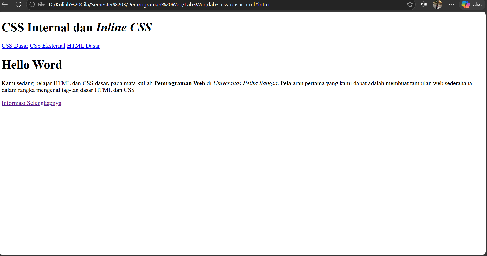
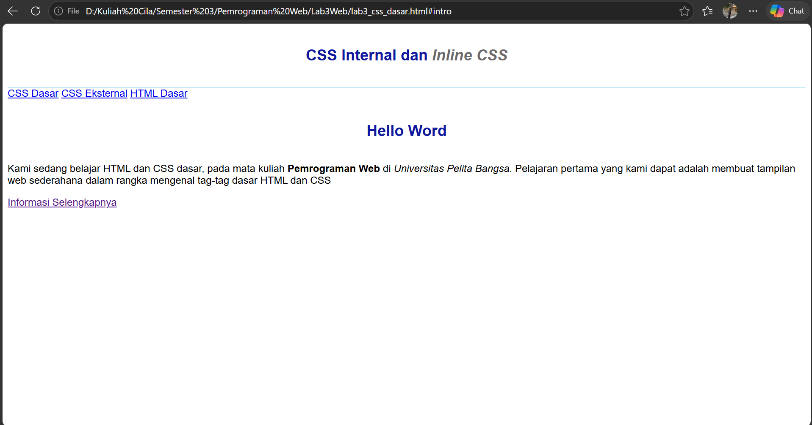
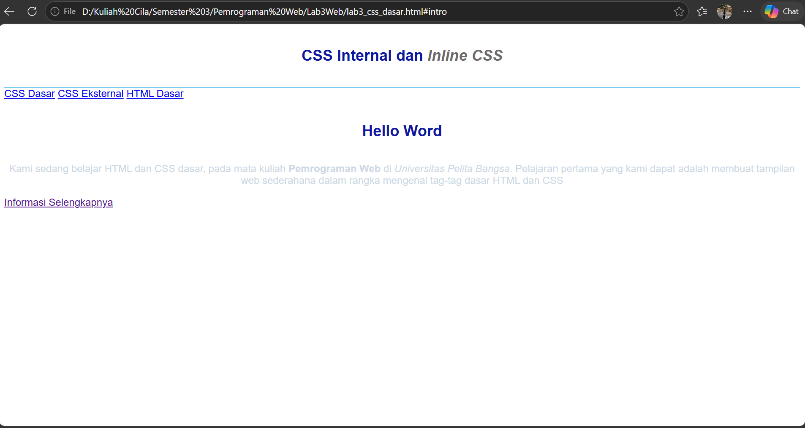
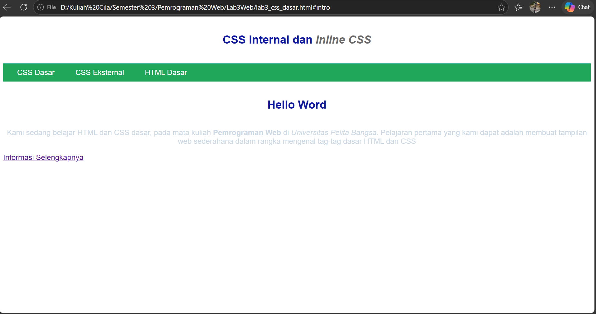
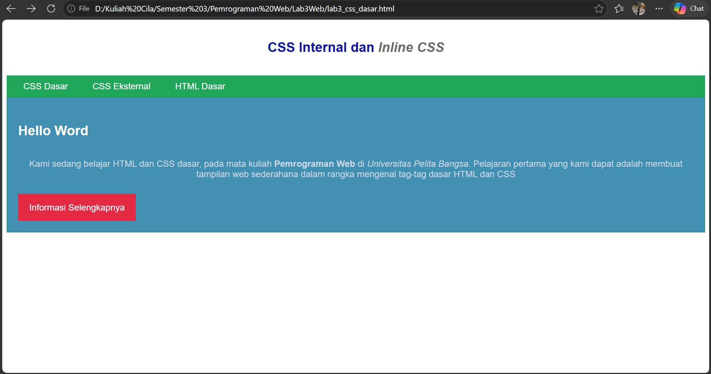

# Praktikum 3: CSS Dasar

Nama: Naysila Rahil Maulana
NIM: 3125101243
Mata Kuliah: Pemrograman Web

## Langkah 1: Membuat Dokumen HTML

Pada langkah ini saya membuat file `lab3_css_dasar.html` yang berisi
struktur dasar HTML: header, nav, dan div intro. Tampilannya masih polos
karena belum ada CSS.

## Langkah 2: Menambahkan CSS Internal

Saya menambahkan tag `<style>` di dalam `<head>`. CSS ini mengatur font,
warna judul, dan garis di bawah header.

## Langkah 3: Menambahkan Inline CSS

Saya menambahkan atribut `style` pada tag `
` sehingga paragraf menjadi
rata tengah dengan warna abu-biru muda.

## Langkah 4: Membuat CSS Eksternal

Saya membuat file `style_eksternal.css` untuk mengatur navigasi, lalu
menghubungkannya dengan tag `<link>`.

## Langkah 5: CSS Selector ID dan Class

Saya menambahkan ID selector (`#intro`) dan class selector (`.button`,
`.btn-primary`) di file CSS eksternal.

